# ClaimGuard: Multi-Agent Insurance Claims Investigation Assistant

Last updated: 2026-11-25

Built by **Mukesh Kumar** · [Portfolio](https://a-iportfolio-sigma.vercel.app/)

<!-- Live demo: add the Vercel URL here once deployed, e.g. **Live demo:** https://claimguard.vercel.app (the first load can take about a minute while the free API wakes up) -->

ClaimGuard is an AI-assisted fraud-investigation tool for insurance claims. Each new claim goes through four stages:

1. A trained **Random Forest** scores it.
2. The claim is compared with the most similar past claims.
3. **Groq** turns the evidence into a recommendation the investigator can read.
4. A **human investigator** makes the final call, and that decision feeds back into the system.

**LangGraph** orchestrates the pipeline, a hardened **FastAPI** backend serves it, and investigators work in a **React** dashboard. The whole thing runs on free tiers: **Render** for the API, **Vercel** for the frontend, **Neon** for Postgres.

### At a glance

| | |
|---|---|
| **Problem** | Investigators triage claims by hand, and an unexplained AI score is hard to trust or act on. |
| **What it does** | Scores each claim, shows the 5 most similar past claims as evidence, and has an LLM explain the next step. A person makes the final decision. |
| **Fraud model** | Random Forest, honest holdout ROC-AUC ≈ 0.83 |
| **Evidence** | Structured similarity: ROC-AUC 0.77, compared with 0.56 for text embeddings |
| **AI guardrails** | The reply is checked against a strict format, and the business rules live in code. The AI can never approve a claim the model flagged. |
| **Reliability** | Every step has a fallback. No failure ends up as a 500, and the screen says what degraded. |
| **Roles** | Admin, investigator and customer. Customers see only a status, never their score. |
| **Quality** | 218 tests that pass on SQLite and Postgres. `ruff`, `bandit` and `pip-audit` are clean. |
| **Cost** | $0 on free tiers (Render, Vercel, Neon, Groq), using about 200 MB of RAM |

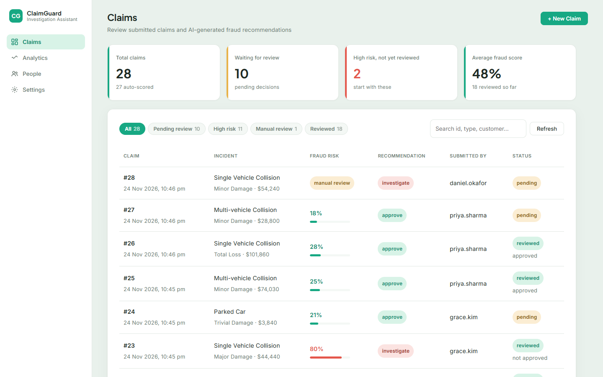

## Contents

- [What makes it different](#what-makes-it-different)
- [Who uses it](#who-uses-it)
- [How it works](#how-it-works)
- [Architecture](#architecture)
- [Screenshots](#screenshots)
- [Security](#security)
- [When things fail](#when-things-fail)
- [The model and the feedback loop](#the-model-and-the-feedback-loop)
- [Tech stack](#tech-stack)
- [Run it locally](#run-it-locally)
- [Deploy your own](#deploy-your-own)
- [What the free-tier deployment leaves out](#what-the-free-tier-deployment-leaves-out)
- [What I learned building it](#what-i-learned-building-it)
- [Known limitations](#known-limitations)
- [Testing](#testing)
- [Project structure](#project-structure)

---

## What makes it different

1. **The LLM explains; code decides.** Groq writes the recommendation, but its reply is schema-validated and the business rules are enforced in Python, not in the prompt. It cannot approve a claim the fraud model flagged, and it cannot deny one the model did not flag. Every correction is shown to the investigator.
2. **It degrades instead of failing.** If Groq, the history lookup or the fraud model breaks, the claim is still saved and still gets a recommendation (rules-based, or routed to a person). The screen says what degraded. No failure ends up as a 500.
3. **Evidence was chosen by measurement, not by trend.** Text embeddings were the first approach, and on the 1,000 historical claims they barely beat a coin flip (ROC-AUC 0.56). A structured similarity scores 0.77, explains every match, and removed about 1 GB of dependencies.
4. **A human always decides, and the system learns from it.** Confirmed decisions join the similar-claims evidence immediately. They can also retrain the model, but a quality gate promotes the new model only if it is not worse.
5. **It is built so it can't be gamed.** Customers file claims and see only *Under review*, *Approved* or *Not approved*. Showing the fraud score would teach a fraudster what to change, so the customer API never sends it.
6. **It runs for $0 in about 200 MB of RAM.** Every Groq call is capped, cached and circuit-broken, and claims the model cannot score never reach the LLM.

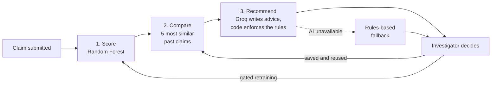

## Who uses it

Everyone signs in on the same page, and the account's role decides what they see. The API checks the role on every route, so hiding a screen is never the only protection.

| Role | Created by | Can do | Never sees |
|---|---|---|---|
| **Admin** | Environment variables, never stored in the database | Everything, plus manage **investigator** accounts and read the activity log | |
| **Investigator** | The admin | See every claim and its full analysis, record decisions, use Analytics, manage **customer** accounts | Other staff accounts |
| **Customer** | The admin or an investigator (there is no public sign-up) | File claims and follow **their own** claims | Fraud score, signals, similar claims, the AI's reasoning, anyone else's claims |

The organization records each customer's policy details once (coverage limit, premium and so on). The customer then describes only the incident and three amounts, and the server merges the two and computes the total.

## How it works

| Step | Module | What it does | If it fails |
|---|---|---|---|
| 1. Score | [`agents/fraud_node.py`](agents/fraud_node.py) | Random Forest fraud probability, readable signals, out-of-range checks | Claim goes to manual review |
| 2. Retrieve | [`retrieval/retrieval_node.py`](retrieval/retrieval_node.py) | The 5 most similar past claims, plus the fraud rate among the 15 most similar | Continues with no evidence and a visible warning |
| 3. Recommend | [`agents/recommendation_node.py`](agents/recommendation_node.py) | Groq writes a structured recommendation; code enforces the rules | Deterministic rules-based recommendation |

Groq's reply is validated against a strict schema, and then code enforces these rules:

- A claim the model could not score can only be `investigate`.
- `approve` is blocked on a claim the fraud model flagged.
- `deny_pending_review` is allowed only when the fraud model itself flagged the claim.
- Empty next steps or key factors are filled from safe defaults.

Every correction is recorded in an `overrides` list and shown in the UI.

### Why "similar claims" don't use embeddings

I measured both approaches with leave-one-out on the 1,000 historical claims. For each claim, the fraud vote of its nearest *other* claims was scored against the true label:

| Retrieval method | ROC-AUC |
|---|---|
| Text embeddings (bge-small), 5 neighbours | 0.564 |
| **Structured (Gower) similarity, 5 neighbours** (shown to the investigator) | **0.705** |
| **Structured similarity, 15 neighbours** (used for the fraud-rate statistic) | **0.767** |

Embeddings find claims that *read* alike, not claims that *behave* alike, and they handle numbers poorly. The structured version compares the incident facts and the four claim amounts. It lists which fields matched, builds in about 0.1 s instead of about 20 minutes, and needs no model download. To reproduce the numbers, run `uv run python scripts/evaluate_retrieval.py`.

## Architecture

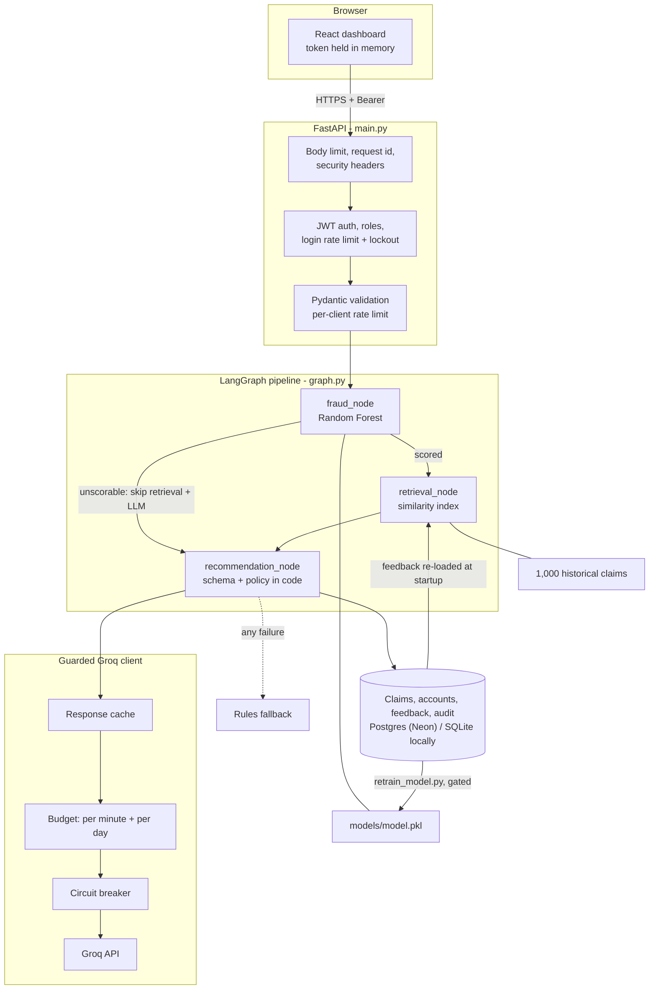

### Where it runs

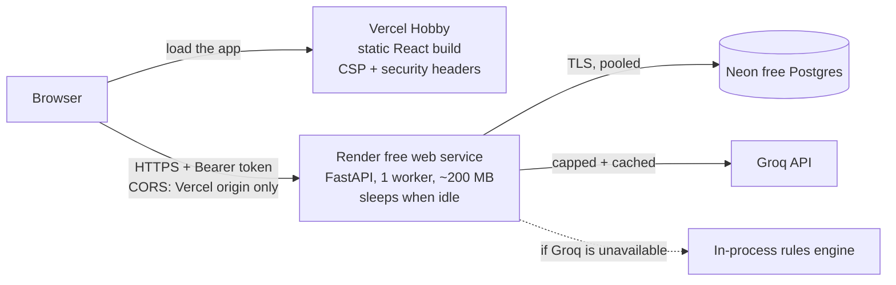

## Screenshots

I captured these from the real app, with sign-in on, a Postgres database and a live Groq model, and I didn't edit them. Every claim went through the real pipeline. The people are fictional. The claim facts are rows from the public dataset the model was trained on, so the scores look better than real-world accuracy would be (the honest holdout ROC-AUC is about 0.83).

**Sign in.** One page for customers and staff. A wrong password gets one generic message, and repeated failures lock the account for 15 minutes.


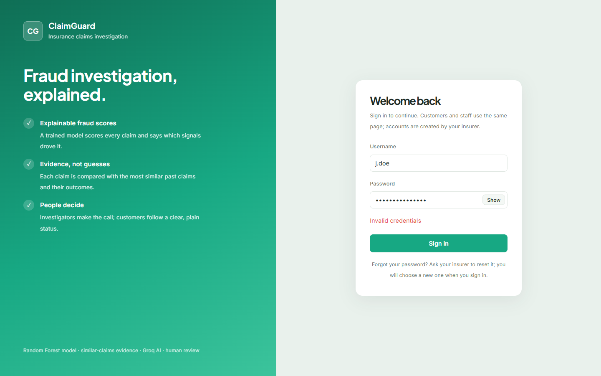

**Choose your password.** Accounts created or reset by the organization start with a temporary password, and nothing else works until the user picks their own.

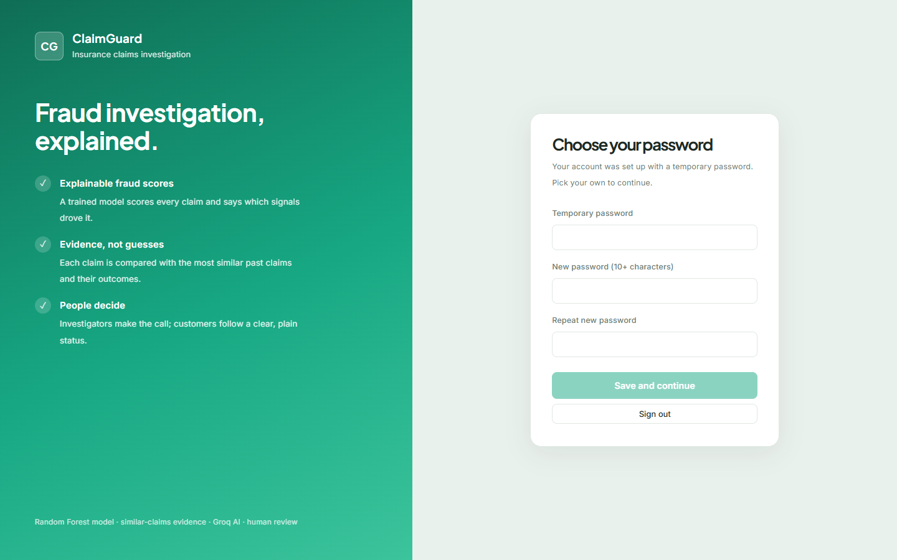

**Claims.** Headline numbers, quick filters, search, a colour-coded fraud risk per claim, and who submitted each one.


**Submit a claim.** All 32 model fields, grouped. Dropdowns allow only values the model was trained on, and the total is computed for you.

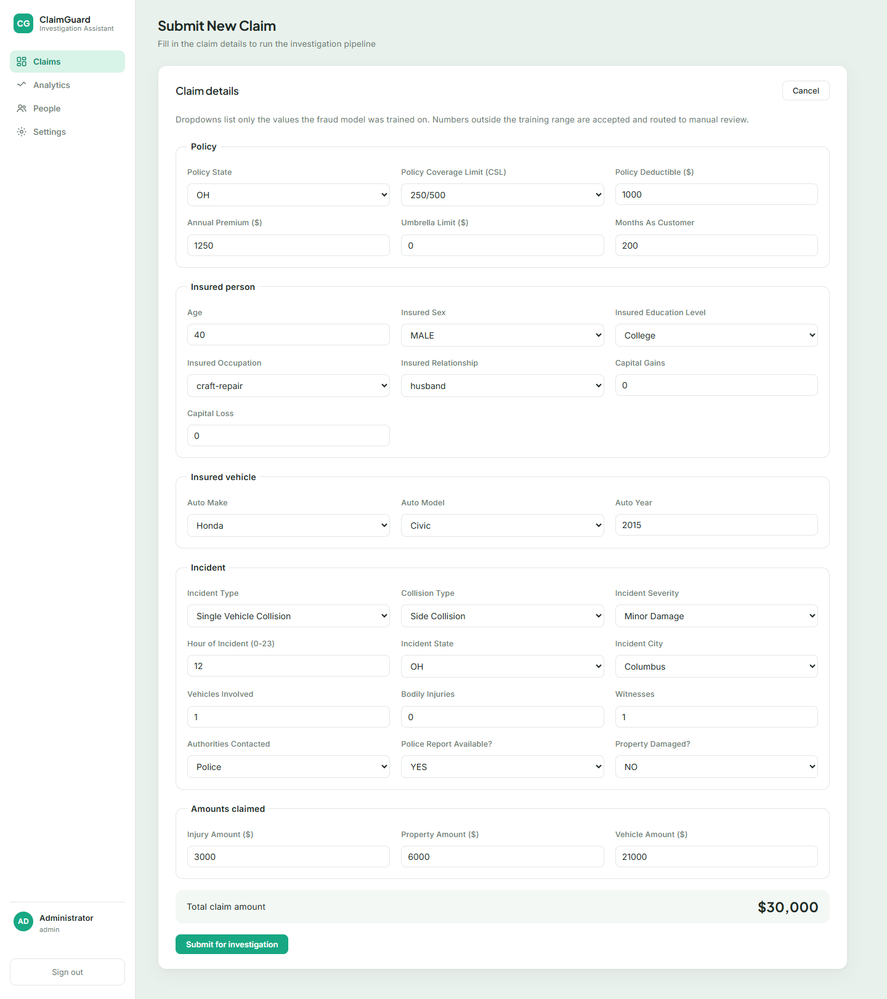

**High-risk claim.** This view has the fraud score and its signals, how many of the 15 most similar past claims were fraud, and the 5 closest with the fields they matched on. Below that are the AI recommendation and the decision form. Nothing is pre-selected, because the answer becomes training data.

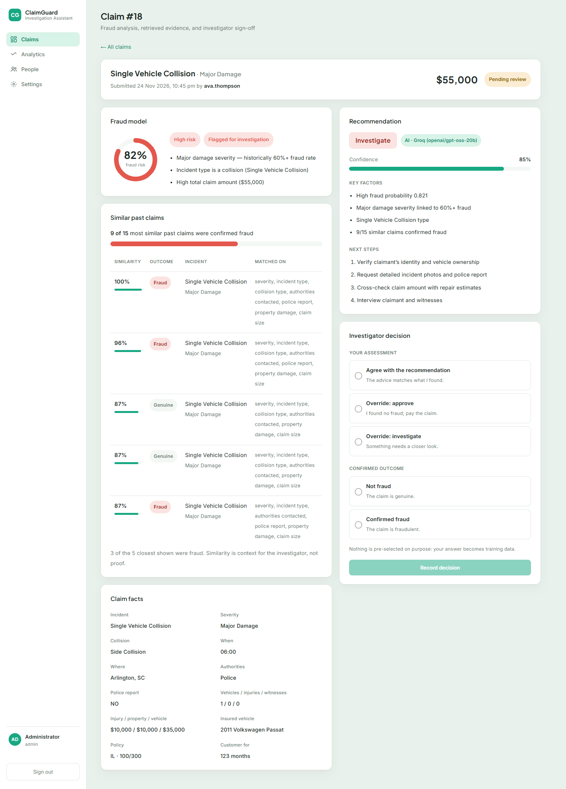

**Low-risk claim.** A low score and mostly genuine similar claims lead to `approve`.

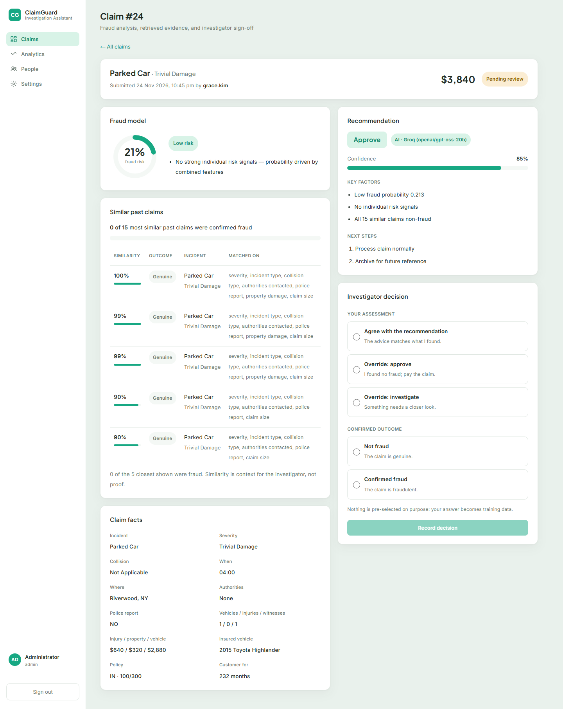

**Unscorable claim.** This claim has a value the model has never seen (`auto_make: Tesla`). It is never auto-scored and never spends a Groq call, and a person reviews it.

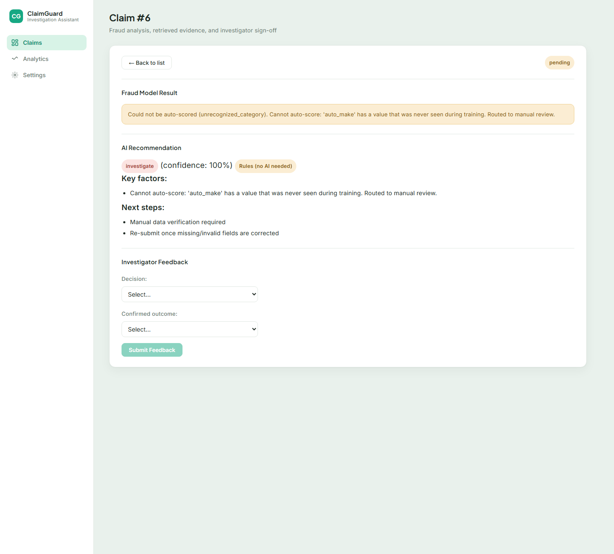

**Reviewed claim.** The investigator confirmed fraud. The customer sees *Not approved*, and the claim now informs future evidence.


**Analytics.** KPIs, risk mix, the score distribution against the 50% threshold, claims over time, risk by severity, incident types, and how much of the advice the AI wrote.

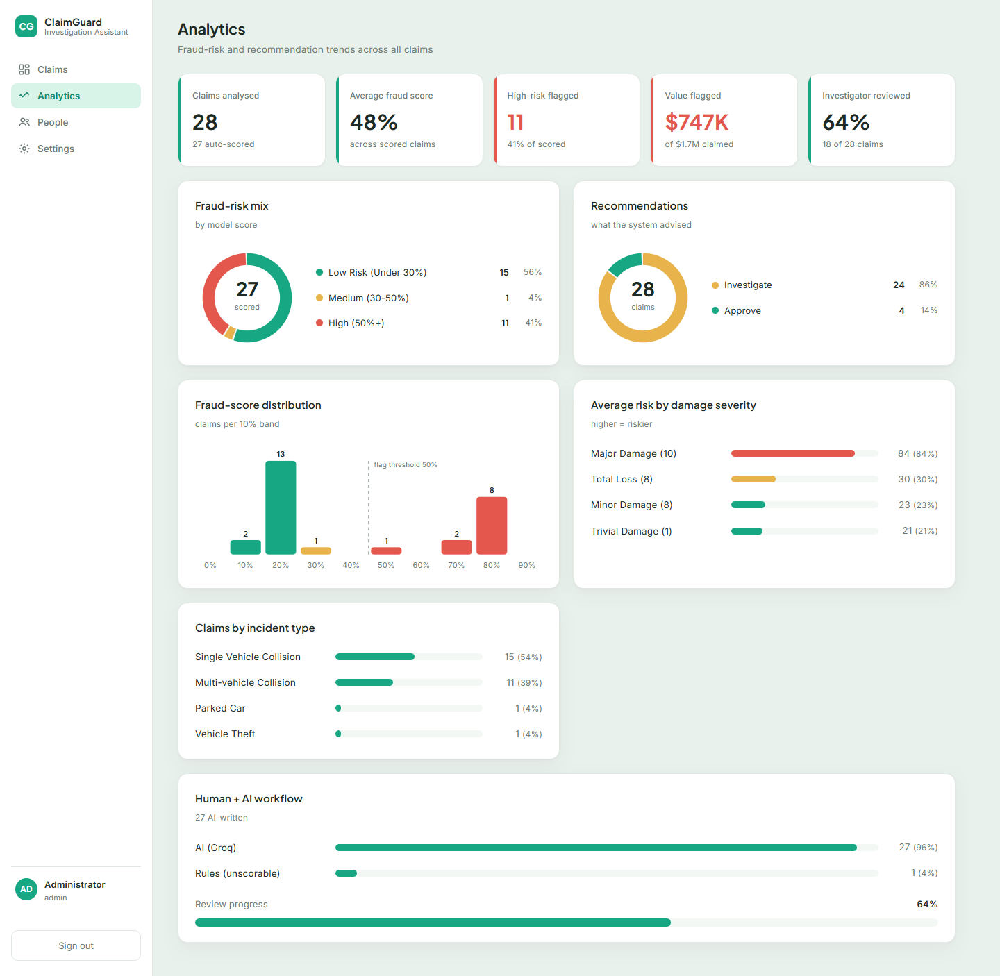

**People and the activity log.** Account management with reset and deactivate, and the admin's log of sign-ins, lockouts, password changes and decisions. Passwords are never logged.

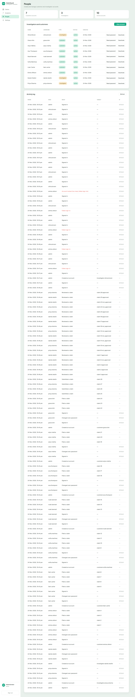

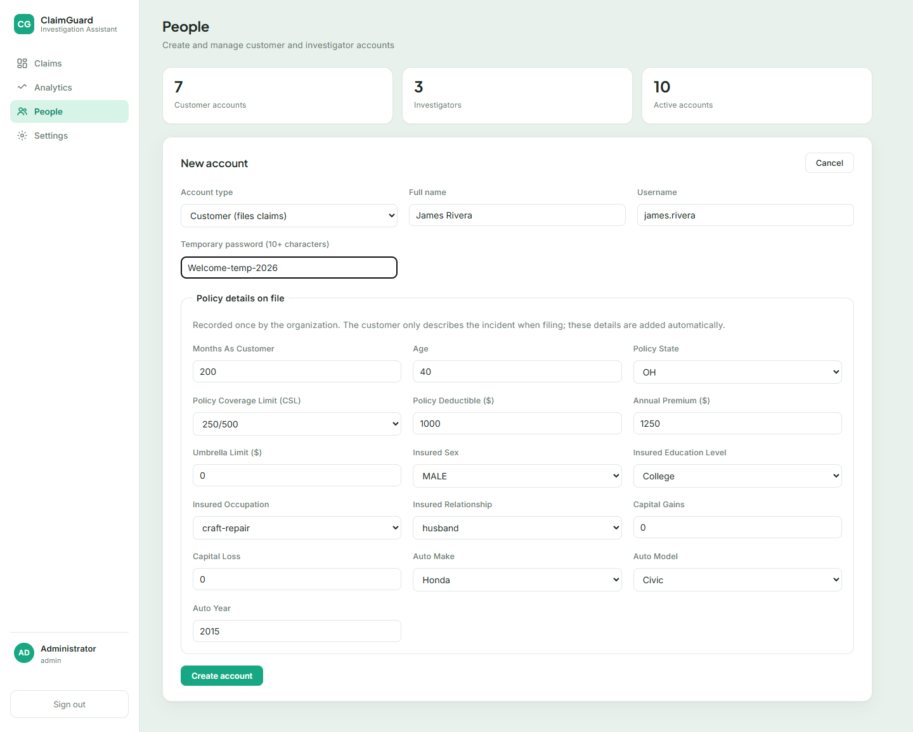

**Settings.** Profile, preferences, and live system status: database, fraud model, similarity index, Groq key and model, circuit breaker and call budget.

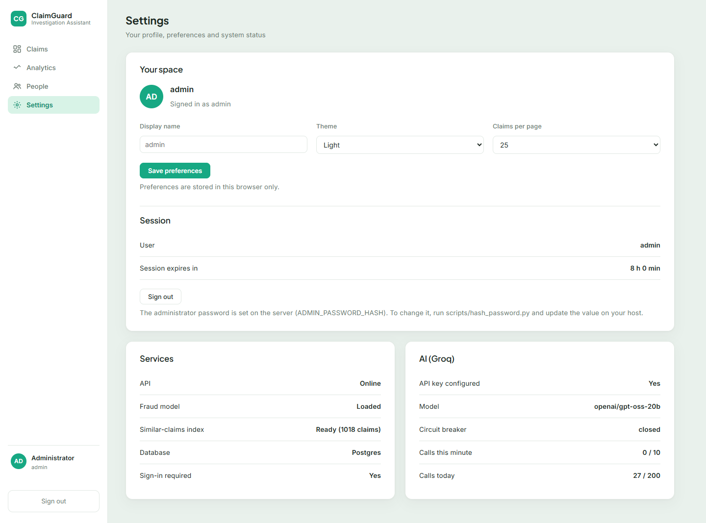

**Customer portal.** The customer sees their own claims with a plain status and a progress tracker. The fraud score and the AI's reasoning never appear here.

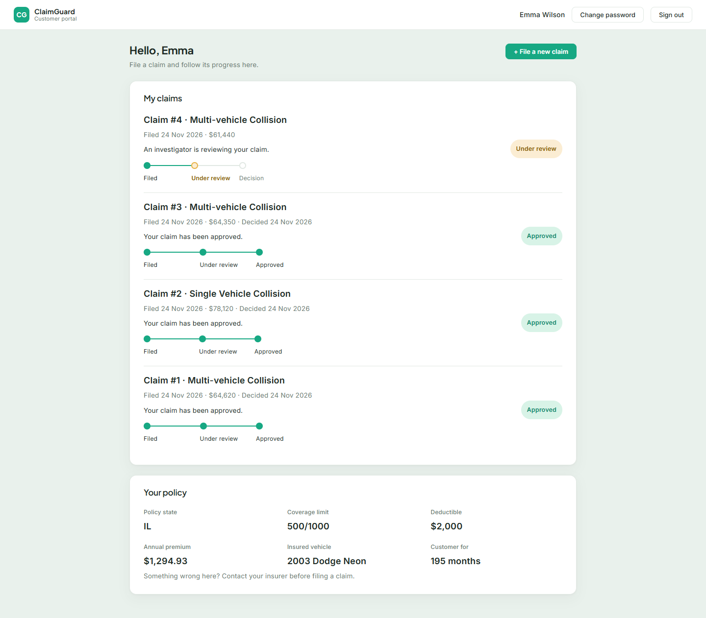

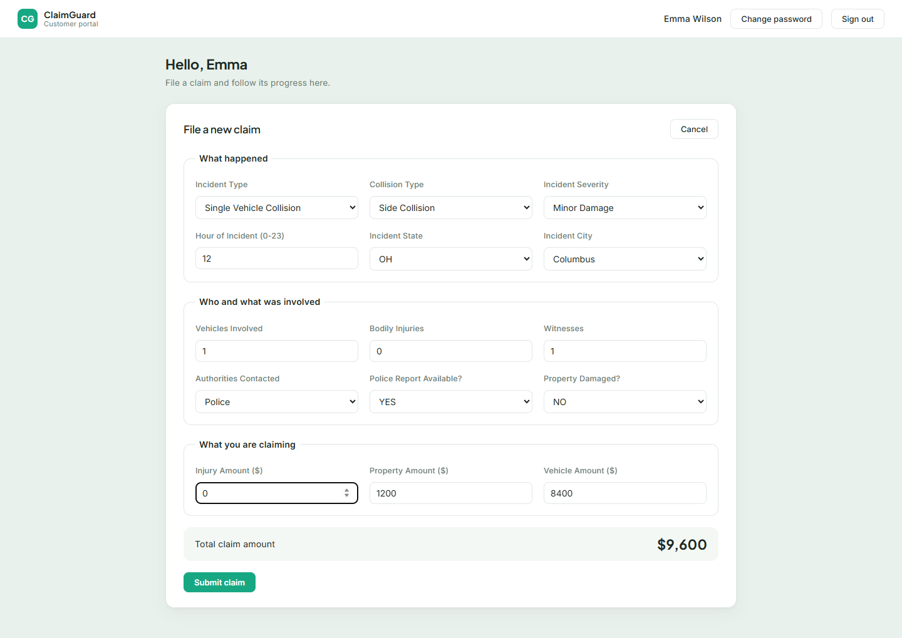

## Security

| Area | What is implemented |
|---|---|
| **Sign-in** | Passwords are stored only as scrypt hashes. Tokens are short-lived signed JWTs (8 h, algorithm and issuer pinned) held in browser memory, never in `localStorage`. A wrong username and a wrong password get the same error and take the same time. |
| **Brute force** | 5 attempts per minute per IP. After 5 consecutive failures, the account locks for 15 minutes. The lockout is stored in the database, so it survives restarts and free-tier sleep. |
| **Fail closed** | In production, the server refuses to start without admin credentials, a strong `JWT_SECRET` and a database. It also refuses `CORS_ORIGINS=*` and any attempt to disable auth. |
| **Authorization** | Roles are checked on every route and re-read from the database on every request, so deactivation takes effect immediately. A customer can only ever read their own claims. |
| **Input** | Every field is bounded, unknown fields are rejected, bodies are capped at 64 KB, and decisions are strict enums. |
| **Headers** | The API sends HSTS, `nosniff`, `X-Frame-Options: DENY` and `no-store`. The frontend has a strict CSP via [`frontend/vercel.json`](frontend/vercel.json). API docs are off in production. |
| **LLM safety** | Claim data is fenced as data in the prompt, and client-supplied text is never echoed into it. The reply is schema-validated, and the rules are enforced in code. |
| **Audit trail** | Sign-ins, failures, lockouts, password and account changes, and claims filed and reviewed are all logged. Passwords, tokens and claim contents never are. |
| **Supply chain** | The lockfile is committed and installs are hash-verified. `pip-audit`, `bandit` and `ruff` (security rules) are clean. |

## When things fail

Each row below is covered by an automated test.

| What fails | What happens |
|---|---|
| No Groq key, Groq timeout, 5xx or rate limit | One capped retry, then the rules-based recommendation, with the reason shown |
| Groq keeps failing | The circuit breaker opens and no calls are made during the cooldown |
| Daily or per-minute Groq budget used up | No call is made; rules fallback |
| Groq returns bad JSON, a wrong enum or an unsafe decision | Rejected or corrected in code, and recorded in `overrides` |
| Fraud model missing, corrupt or erroring | The API still boots, and every claim goes to manual review |
| Unseen category or missing field | Manual review, with no retrieval and no Groq call |
| History unavailable | The recommendation uses the model score only, with a visible warning |
| Same claim reviewed twice | `409`, so no duplicate training row is written |
| Backend asleep (free hosting) | "Connecting..." with a Retry button instead of an error |

**Groq call limits** (all configurable in [`.env.example`](.env.example)):

- 10 calls per minute and 200 per day, with retries counted against the limit
- 600 output tokens per call and a 20 s timeout
- The circuit breaker opens after 3 failures for 60 s
- Identical inputs are cached for 1 hour

## The model and the feedback loop

- **Retrieval learns immediately.** A reviewed claim is added to the similarity index straight away. At startup, the index is rebuilt from the CSV plus every feedback row, so it is a derived cache, never a second source of truth.
- **The classifier retrains only when you run it, and only through a quality gate.** Run `retrain_model.py --dry-run` to see the metrics without changing anything. Without the flag, the new model is promoted only if its ROC-AUC is at least 0.70 and no more than 0.03 below a fair baseline trained on the same split. The previous model is archived, and the new one is written atomically.

Holdout results on the committed data (1,000 rows, 200 held out):

| Model | ROC-AUC | Precision | Recall | F1 |
|---|---|---|---|---|
| Candidate (original + feedback) | 0.831 | 0.632 | 0.720 | 0.673 |
| Baseline (original only) | 0.829 | 0.621 | 0.720 | 0.667 |
| Production model (saw most of the holdout, so **not** a fair estimate) | 0.962 | 0.677 | 0.880 | 0.765 |

The honest expectation for unseen claims is an AUC of about 0.83, not 0.96.

## Tech stack

| Layer | Tools |
|---|---|
| Orchestration | LangGraph |
| ML | scikit-learn (Random Forest), pandas, NumPy; Gower similarity written from scratch |
| LLM | Groq (`openai/gpt-oss-20b` by default), called with `httpx` in JSON mode |
| API | FastAPI, Pydantic, PyJWT, Uvicorn |
| Data | SQLAlchemy Core, Postgres (Neon) in production, SQLite locally |
| Frontend | React + Vite |
| Hosting | Render (API), Vercel (frontend), Neon (database), all on free tiers |
| Quality | pytest (218 tests), ruff, bandit, pip-audit, `uv` with a locked, hash-verified install |

## Run it locally

You need Python 3.12+ with [`uv`](https://docs.astral.sh/uv/), and Node.js. A Groq key from [console.groq.com/keys](https://console.groq.com/keys) is optional: without one, the app uses its rules-based fallback.

```bash
uv sync
cd frontend && npm ci && cd ..
cp .env.example .env        # add GROQ_API_KEY; AUTH_DISABLED=true skips sign-in locally

uv run uvicorn main:app --reload          # API on http://127.0.0.1:8000 (docs at /docs)
cd frontend && npm run dev                # UI on http://localhost:5173 (second terminal)
```

With `AUTH_DISABLED=true`, you are signed in as an admin. To try the customer portal, you need real accounts:

1. Run `uv run python scripts/hash_password.py`.
2. Put the printed values in `.env` and set `AUTH_DISABLED=false`.
3. Restart the API, then create users on the **People** page.

Every setting is documented in [`.env.example`](.env.example).

## Deploy your own

The repository includes the hosting configuration: [`render.yaml`](render.yaml) is a Render Blueprint for the API, and [`frontend/vercel.json`](frontend/vercel.json) configures the frontend. In outline:

1. Create a free **Neon** Postgres project and copy its connection string.
2. Generate an admin password hash with `scripts/hash_password.py`.
3. On **Render**, create a new Blueprint from this repo and fill in `DATABASE_URL`, `ADMIN_USERNAME`, `ADMIN_PASSWORD_HASH`, `GROQ_API_KEY` and `CORS_ORIGINS`.
4. On **Vercel**, import the repo with root directory `frontend`, and set `VITE_API_URL` to the Render URL.
5. Set `CORS_ORIGINS` on Render to the exact Vercel URL.

Tables are created on first start. Run a single instance with one worker, because the Groq budget and rate limiters live in memory.

## What the free-tier deployment leaves out

The live demo runs entirely on free plans. That shapes what it can and cannot do, and none of these gaps would need a code change to fix with paid hosting:

| Missing in the free deployment | Why | What a paid setup would add |
|---|---|---|
| **Instant first load** | Render's free service sleeps after about 15 minutes idle, so the next visit waits about a minute. | An always-on instance |
| **Shared, durable limits** | The Groq budget, circuit breaker, response cache and per-IP rate limits live in process memory. They reset every time the free instance sleeps, and they force a single instance. (Lockouts and the audit log *are* in the database.) | Redis, plus horizontal scaling |
| **Retraining in production** | Render's free filesystem is wiped on every restart, so a model retrained on the server would be lost. Retraining runs locally, and the new `model.pkl` ships with the next deploy. | A persistent disk or object storage, plus a model registry |
| **Scheduled backups** | Free plans don't include cron jobs, and Neon's free restore window is short. `scripts/backup_db.py` exists but has to be run by hand. | Nightly automated backups with tested restores |
| **Email** (forgot-password, claim-status notifications) | Needs an email provider. Passwords are reset by the organization instead. | A transactional email service |
| **Document and photo uploads** | Needs object storage, and the model is tabular-only anyway. | S3-style storage plus document analysis |
| **Monitoring and alerting** | Only the hosts' log viewers. `/health` exposes the right signals, but nothing watches them. | Uptime checks, error tracking, log retention |
| **A staging environment** | One free service and one database. Vercel preview URLs aren't in the CORS allow-list. | A separate staging API and database |
| **AI on every claim under load** | Groq's free tier has rate limits, and the app caps itself at 200 calls a day. Past that, recommendations come from the rules engine. | A paid Groq plan with higher caps |
| **Commercial use** | Vercel Hobby is for personal, non-commercial projects. | Vercel Pro or another host |

## What I learned building it

1. **Measure before you pick the fashionable option.** I assumed embeddings and a vector database were the right way to find similar claims. Measuring showed they were almost random (AUC 0.56). The simpler structured similarity scored 0.77, removed about 1 GB of dependencies, and cut the index build from about 20 minutes to 0.1 s.
2. **Never trust LLM output as a decision.** Groq once approved a claim with no next steps at all. The fix was to validate every reply against a schema and move the business rules out of the prompt into code. A prompt is a request; code is a guarantee.
3. **User input can reach the prompt through side doors.** The fraud node used to echo an unseen category value back into its signals, which went straight into the LLM prompt. That was a prompt-injection path hidden in what looked like a helpful error message.
4. **A failure in one step should cost one step, not the whole request.** Early on, an unreachable LLM caused a 500 and the claim was never saved. Wrapping each step with its own fallback and showing the user what degraded made the system reliable without making it complicated.
5. **Evaluate against something fair.** My first retraining gate compared new models to the production model. The production model had already seen most of the holdout, so every retrain would have failed. The right comparison is a baseline trained on the same split. Likewise, 0.96 AUC was flattering; 0.83 is the honest number.
6. **Idempotency matters wherever data becomes training data.** Submitting feedback twice wrote duplicate training rows. A unique constraint and a `409` fixed it, but it would have silently skewed the model.
7. **Free hosting is a design constraint, not just a price.** An ephemeral filesystem pushed all data into Postgres. A sleeping server pushed lockouts into the database. A scale-to-zero database meant `/health` must not query it, or health checks would keep it awake and burn the compute quota.
8. **Fewer dependencies is a security feature.** An audit found 123 advisories across transitive packages. Removing the embeddings stack and upgrading the lockfile cleared every one of them.
9. **Product decisions are part of fraud prevention.** Hiding the fraud score from customers isn't a UI choice. It stops the system from teaching people how to beat it.
10. **Test against the database you deploy on.** The suite runs on both SQLite and Postgres, and reading `render.yaml` before the first deploy caught a build step that would have failed (it called a module I had already deleted).

## Known limitations

Beyond the hosting gaps above, these are real limits of the system itself:

- **Small, public dataset.** The model trains on 1,000 rows of the public Kaggle auto-insurance dataset. About one in three flagged claims is a false alarm, and the 0.5 threshold is neither tuned nor calibrated.
- **Protected attributes are model inputs.** Sex, age, education, occupation and relationship are features. They would need a fairness and regulatory review before the score could inform real decisions.
- **Explanations are rules, not attributions.** Fraud signals are hand-written checks; SHAP-style explanations are not implemented.
- **The LLM adds explanation, not information.** It sees only the score, signals and similar-claims statistic. The rules stop it from being *less* cautious than the model, but it can be more cautious.
- **Similarity is context, not proof.** Its 0.77 AUC is well below the classifier's.
- **No two-factor sign-in.** The audit log records actions, not who viewed which claim.
- **A page refresh signs you out.** The token is held only in memory, a deliberate trade-off against XSS.
- **The customer portal is status-only.** Customers can't edit or withdraw a claim, or message an investigator.
- **The model is a pickle.** Only load model files you trained yourself, and restart the API after retraining.

## Testing

```bash
uv run python -m pytest -q
```

There are **218 tests**, and they pass on SQLite and on Postgres 16 (set `TEST_DATABASE_URL` to run them on Postgres). The suite never touches the network: Groq is replaced by a fake. It covers the call guards, the Groq client, schema and policy enforcement, every fallback path, auth (including token tampering and `alg=none` forgery), roles, request protections, retrieval, persistence and the retraining gate. On top of the tests, `ruff` (with security rules), `bandit` and `pip-audit` are clean.

## Project structure

```
.
├── main.py                 FastAPI app: routes, validation, rate limits
├── auth.py                 scrypt passwords, JWT, roles, fail-closed startup checks
├── graph.py                LangGraph pipeline with per-step guards and warnings
├── resilience.py           budget, circuit breaker, TTL cache, rate limiter
├── middleware.py           body limit, request ids, security headers
├── config.py               environment-driven settings
├── retrain_model.py        gated retraining
├── agents/                 fraud scoring, guarded Groq client, recommendation, feedback
├── retrieval/              Gower similarity index and the retrieval step
├── db/                     one schema for SQLite and Postgres; claims, users, lockouts, audit
├── scripts/                password hash, backup/restore, retrieval evaluation
├── frontend/               React + Vite dashboard and customer portal
├── tests/                  pytest suite
├── data/                   historical claims (training + retrieval)
├── models/                 trained classifier
└── render.yaml             Render Blueprint for the API
```

## Author

**Mukesh Kumar**. See more of my work on my [portfolio](https://a-iportfolio-sigma.vercel.app/).

## License

This is a personal portfolio project. It re-implements work originally done with an OpenAI API key and now uses Groq. No license file is included, so all rights are reserved unless one is added.
