# ClaimGuard: Multi-Agent Insurance Claims Investigation Assistant

Last updated: 2026-11-23 08:30 PM IST

An AI-assisted fraud-investigation tool for insurance claims. A new claim is scored by a trained Random Forest, compared with similar past claims, turned into an explainable recommendation by **Groq**, and handed to a human investigator whose confirmed outcome feeds back into the system. It is orchestrated with **LangGraph**, served by a hardened **FastAPI** backend, and reviewed in a **React** dashboard, deployable on **Render** (API) and **Vercel** (frontend).

It is designed to **degrade, not die**: every external dependency has a fallback, every Groq call is capped, and the whole backend runs in about **200 MB of RAM**.

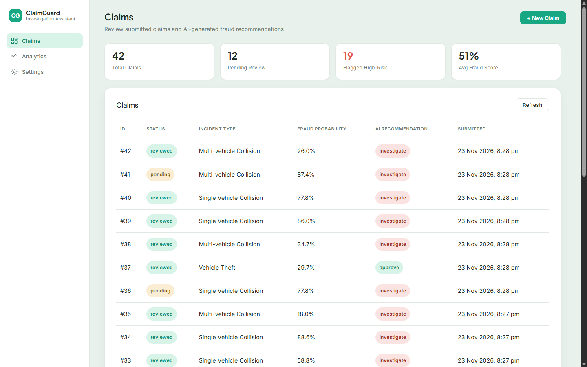

## Contents

- [Why ClaimGuard: the advantages](#why-claimguard-the-advantages)
- [How it works](#how-it-works)
- [Architecture](#architecture)
- [Screenshots](#screenshots)
- [Security](#security)
- [Failure handling and fallbacks](#failure-handling-and-fallbacks)
- [Limiting Groq API calls](#limiting-groq-api-calls)
- [Local setup](#local-setup)
- [Configuration](#configuration)
- [Deployment: Render + Vercel](#deployment-render--vercel)
- [API reference](#api-reference)
- [Feedback loop and retraining](#feedback-loop-and-retraining)
- [Testing](#testing)
- [Project structure](#project-structure)
- [Operations](#operations)
- [Troubleshooting](#troubleshooting)
- [Known limitations](#known-limitations)

---

## Why ClaimGuard: the advantages

| Advantage | What it means in practice |
|---|---|
| **A human always decides** | The AI recommends; an investigator confirms or overrides. Nothing is denied automatically, and `approve` is blocked on any claim the fraud model flagged. |
| **Every answer is explained** | Each claim shows the fraud score, the plain-English signals behind it, the 5 most similar past claims (with the fields they matched on), and the AI's reasoning. |
| **It never fails silently** | If the AI, the history lookup or the fraud model breaks, the claim still gets a recommendation (rules-based or manual review) and the screen says what degraded. |
| **It gets better with use** | Investigator decisions are saved, added to the similar-claims evidence immediately, and can retrain the model, but only if the new model is not worse (quality gate). |
| **Cheap and predictable to run** | Groq calls are capped per minute and per day, repeated claims are cached, unscorable claims skip the AI entirely, and the backend needs about 200 MB of RAM. |
| **Safe to put on the internet** | Login, rate limits, strict input validation, security headers, no secrets or claim data in logs, and the AI is told to treat claim text as data, never as instructions. |
| **Measured, not guessed** | Retrieval was chosen by testing against the 1,000 historical claims (ROC-AUC 0.77 vs 0.56 for embeddings), and the fraud model holds out 20% of data for honest evaluation (AUC about 0.83). |
| **Easy to host** | One-click-style setup: Render for the API, Vercel for the dashboard, both described by config files in the repo. |

### The system at a glance

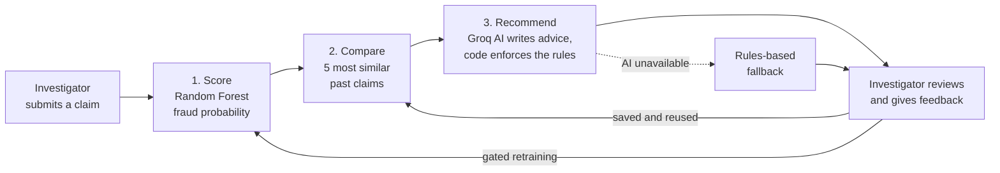

### Dashboard pages

- **Claims**: list, submit and review claims.
- **Analytics**: headline KPIs, risk mix, score distribution, claims over time, risk by severity, incident types, AI versus rules share.
- **Settings**: your profile and preferences, plus live system status (fraud model, history index, Groq key/model, circuit breaker, call budget used).

---

## How it works

For every submitted claim the pipeline runs three steps. Each step is wrapped so that a failure degrades that step, and is shown to the user, instead of failing the request.

| Step | Module | What it does | If it fails |
|---|---|---|---|
| 1. Score | [`agents/fraud_node.py`](agents/fraud_node.py) | Random Forest fraud probability, readable signals, out-of-range checks | Claim is routed to manual review |
| 2. Retrieve | [`retrieval/retrieval_node.py`](retrieval/retrieval_node.py) | The 5 most similar past claims, plus the fraud rate among the 15 most similar | Continues with no evidence and a visible warning |
| 3. Recommend | [`agents/recommendation_node.py`](agents/recommendation_node.py) | Groq writes a structured recommendation; code enforces the business rules | Deterministic rules-based recommendation |

**The LLM explains; code decides what is allowed.** Groq's reply is validated against a strict schema, then the rules are applied in code:

- a claim the model could not score can only be `investigate`;
- `approve` is not allowed on a claim the fraud model flagged;
- `deny_pending_review` (an adverse action) is only allowed when the fraud model itself flagged the claim;
- an empty list of next steps or key factors is backfilled from safe defaults, and when a rule reverses the model's decision its now-contradictory next steps are replaced.

Every correction is recorded in the recommendation's `overrides` list and shown in the UI.

### How "similar claims" are found, and why not embeddings

The first version embedded each claim as text and searched a vector index. I measured it: for each of the 1,000 historical claims, the fraud vote of its 5 nearest *other* claims scored a ROC-AUC of **0.56**, barely better than a coin flip (0.5). Text embeddings find claims that *read* alike, not claims that *behave* alike, and they handle numbers poorly.

The shipped approach is an interpretable mixed-type (Gower) distance over the facts of the incident (severity, incident type, collision type, authorities contacted, police report, property damage) and the four claim amounts:

| Retrieval method | Leave-one-out ROC-AUC |
|---|---|
| Text embeddings (bge-small), 5 neighbours | 0.564 |
| **Structured similarity, 5 neighbours** (shown to the investigator) | **0.705** |
| **Structured similarity, 15 neighbours** (used for the fraud-rate statistic) | **0.767** |

It is also explainable (each result lists the fields it matched), needs no model download or ONNX runtime, builds in about 0.1 s, and removed roughly 1 GB of dependencies. Reproduce the figures with `uv run python scripts/evaluate_retrieval.py`.

<sub>[↑ Back to contents](#contents)</sub>

## Architecture

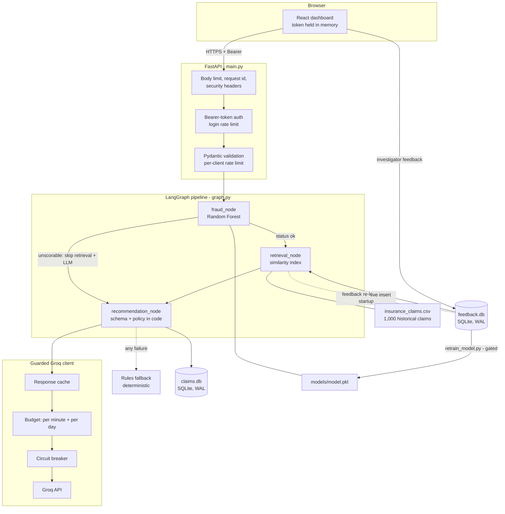

### Request lifecycle

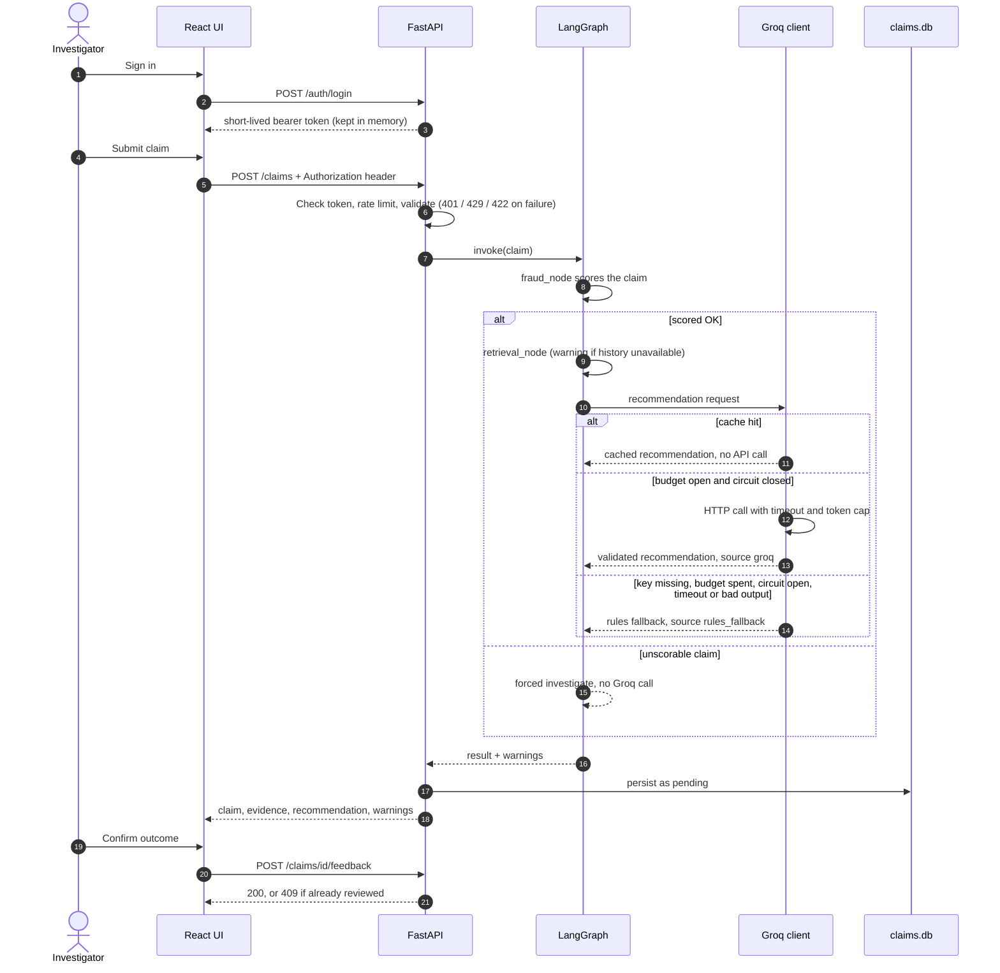

### Deployment topology

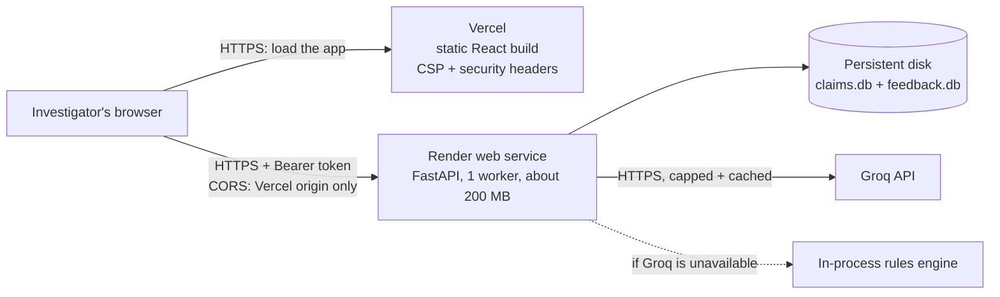

### Claim lifecycle

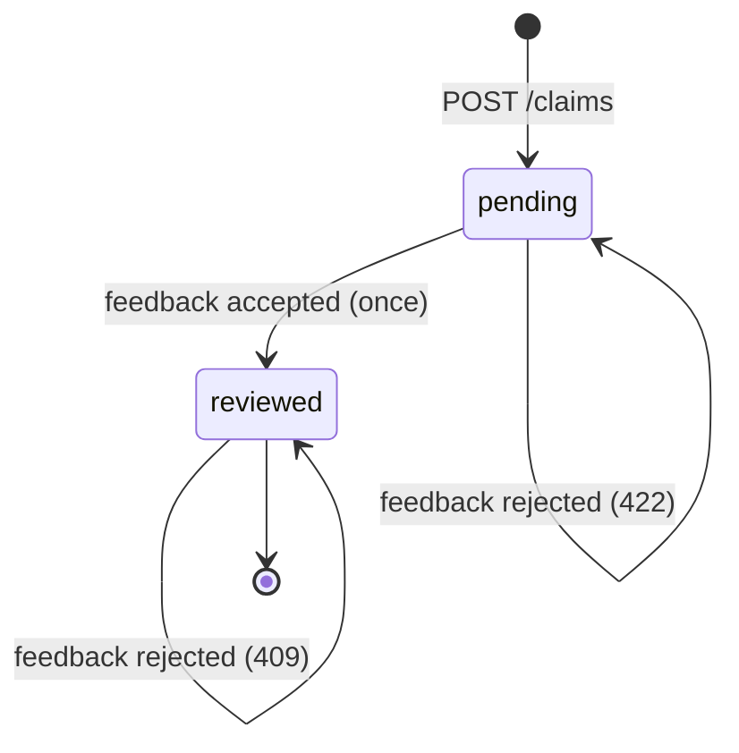

<sub>[↑ Back to contents](#contents)</sub>

## Screenshots

> **About these screenshots.** They come from the real app running against a **live Groq model**. The claims are **sample rows from the public dataset the fraud model was trained on**, so the scores look better than real-world accuracy would (the honest holdout ROC-AUC is about 0.83). They show how the product works, not how accurate it is. Nothing in the images was edited. The login screens (01, 02) were captured earlier in production mode.

### Sign in
The API refuses every claims request without a token. A wrong password gets one generic message, whether the username or the password was wrong.

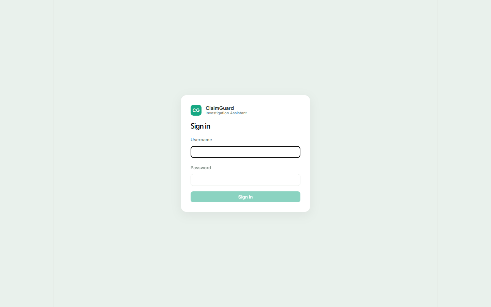


### Dashboard
Totals, flagged claims, and a list with each claim's fraud probability and recommendation. The sidebar switches between Claims, Analytics and Settings.


### Analytics dashboard
Risk mix, recommendation split, fraud-score distribution with the flag threshold, claims over time, average risk by damage severity, incident types, and how much of the advice was written by the AI versus the rules fallback.


### Settings
A personal space (display name, theme, claims per page, session) above live system status: fraud model, history index, Groq key, model, circuit breaker and call budget.

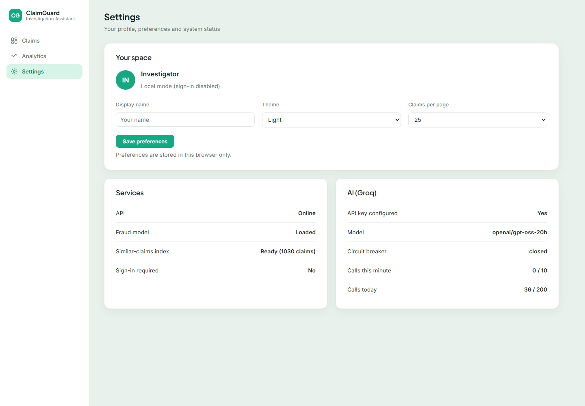

### Submit a claim
Categorical fields are dropdowns restricted to the values the model was trained on.

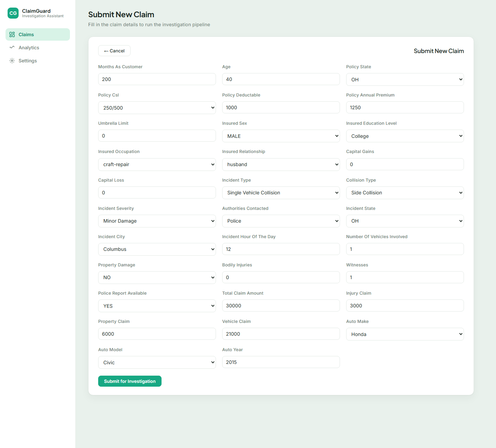

### High-risk claim
The fraud score and signals, the **fraud rate among the 15 most similar claims**, the 5 closest claims with **which fields matched**, and the Groq recommendation with its source.

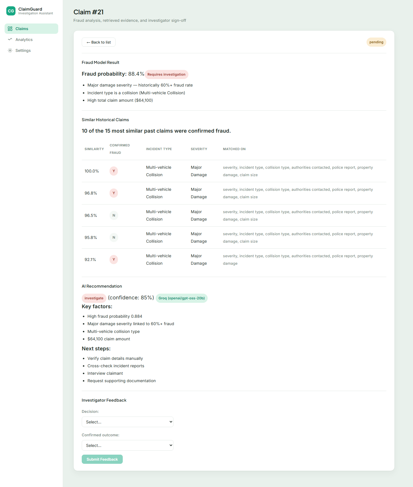

### Low-risk claim
0 of the 15 most similar claims were fraud and the model score is low, so the recommendation is `approve`.

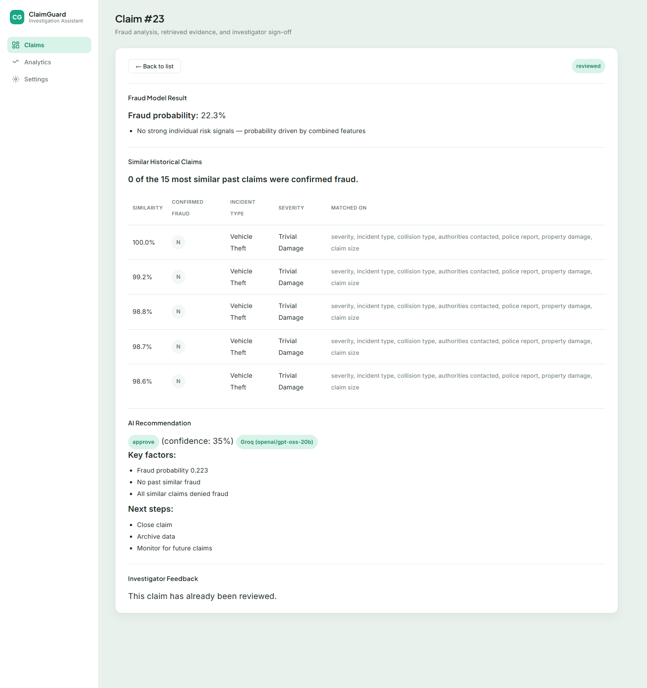

### Investigator feedback
Nothing is pre-selected: the answer becomes training data, so the investigator must choose explicitly.

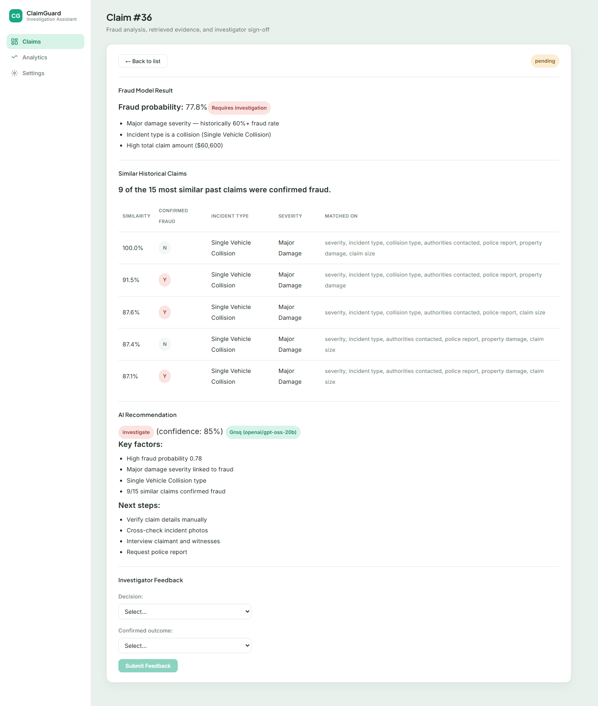

### Unscorable claim, routed to manual review
A claim with a value the model has never seen (`auto_make: Tesla`) is never auto-scored, never retrieves evidence, and never spends a Groq call.


### Reviewed claim

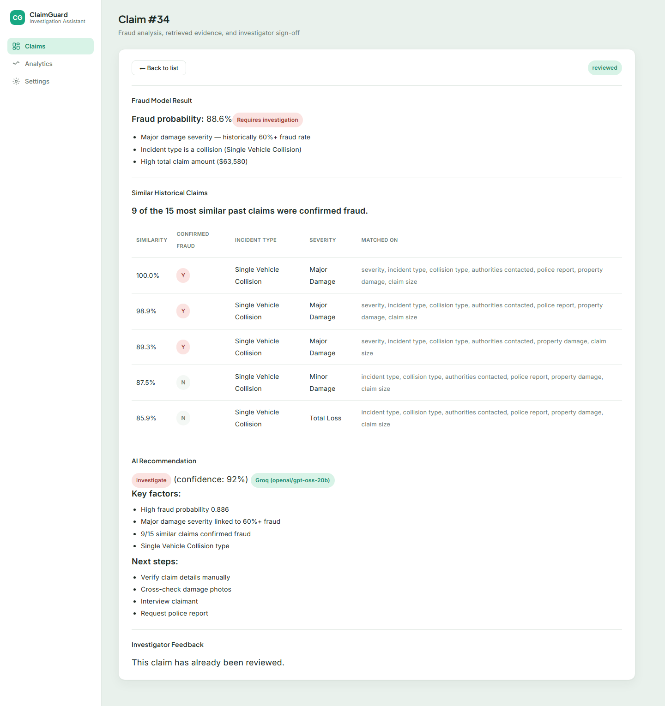

<sub>[↑ Back to contents](#contents)</sub>

## Security

| Area | What is implemented |
|---|---|
| **Authentication** | Single operator account. Password stored only as a **scrypt** hash; constant-time comparison; an unknown username costs the same as a wrong password. Short-lived signed **JWT** (HS256, 8 h, issuer and algorithm pinned). The token lives **in browser memory only**, never in `localStorage`. |
| **Fail closed** | Auth is on unless `AUTH_DISABLED` is set, and that flag is **refused when `ENVIRONMENT=production`**. In production the server refuses to start without `ADMIN_USERNAME`, `ADMIN_PASSWORD_HASH` and a 32+ character `JWT_SECRET`, or with `CORS_ORIGINS=*`. |
| **Brute force** | 5 login attempts per minute per client; failed attempts are logged without the attempted username or password. |
| **Authorization** | Every `/claims` route requires a valid token (401 with `WWW-Authenticate` otherwise). Only `/health`, `/auth/config` and `/auth/login` are public. |
| **Input validation** | Every field bounded (lengths, numeric ranges), unknown fields rejected, request body capped at 64 KB (checked on the declared length *and* while streaming), feedback values are strict enums. |
| **Transport and headers** | API: HSTS, `nosniff`, `X-Frame-Options: DENY`, `Referrer-Policy: no-referrer`, `Cache-Control: no-store`. Frontend: CSP, `frame-ancestors 'none'`, HSTS and more via [`frontend/vercel.json`](frontend/vercel.json). |
| **CORS** | Explicit allow-list of origins, `GET`/`POST` only, no credentials. |
| **Attack surface** | `/docs`, `/redoc` and the OpenAPI schema are disabled in production. Unhandled errors return a generic 500 plus a request id; the traceback stays in the server log. |
| **Secrets** | Environment variables only; `.env` is git-ignored; `.env.example` holds no values. A log sweep over a full end-to-end run found no password, token, API key or claim data. |
| **LLM safety** | Claim data is fenced as data in the prompt; the reply is schema-validated; business rules are enforced in code; a client-supplied string is never echoed into the prompt. |
| **Cost abuse** | Per-client rate limit on submissions plus Groq budgets, a circuit breaker and a cache (see below). |
| **Supply chain** | `uv.lock` is committed and the build installs with `--frozen` (hash-verified). `pip-audit`, `bandit` and `ruff` (with security rules) are clean; see [Testing](#testing). |

What this deliberately is **not**: a multi-user system. See [known limitations](#known-limitations).

<sub>[↑ Back to contents](#contents)</sub>

## Failure handling and fallbacks

Nothing below surfaces as a 500. Each row is covered by an automated test.

| What fails | What happens | Where it is visible |
|---|---|---|
| `GROQ_API_KEY` not set | No network call; rules-based recommendation | `source: rules_fallback`, reason `no_api_key` |
| Groq timeout, network error, 5xx | At most `GROQ_MAX_RETRIES` retries, then rules fallback | warning banner, reason `timeout` / `http_503` ... |
| Groq rate limit (429) | Groq's `retry-after` is honoured if it is at most `GROQ_MAX_RETRY_WAIT_S` seconds; a longer wait falls back to rules at once, so a request never stalls | reason `rate_limited` or `http_429` |
| Groq auth/validation error (401, 400 ...) | Not retried, rules fallback | reason `http_401` ... |
| Groq keeps failing | Circuit opens for a cooldown, no more calls | reason `circuit_open`, `GET /health` |
| Daily or per-minute budget used up | No call is made | reason `budget_exhausted` |
| Groq returns prose, bad JSON, wrong enum, confidence outside 0-1 | Reply rejected, rules fallback | reason `invalid_llm_output` |
| Groq returns empty next steps or key factors | Backfilled with safe defaults and flagged | `overrides` list in the UI |
| Groq tries to approve a flagged claim | Corrected in code to `investigate`, steps replaced | `overrides` list in the UI |
| Fraud model file missing or corrupt | API still boots; every claim goes to manual review | status `model_unavailable`, `GET /health` |
| Fraud model raises while scoring | Manual review | status `scoring_error` |
| Unseen category or missing field | Manual review; no retrieval, no Groq call | status `unrecognized_category` / `missing_field` |
| Historical claims cannot be loaded, or retrieval errors | Recommendation uses the model score only | warning "Historical claims could not be loaded" |
| Index update fails after feedback | Feedback is still saved (the index is a derived cache) | response `indexed: false` |
| Same claim reviewed twice | Rejected, no duplicate training row | HTTP 409 |
| Backend asleep (free hosting) | The app shows "Connecting..." with a retry button instead of an error | login/connection screen |
| A corrupt JSON cell in the database | That cell reads as empty; the list still loads | logged warning |

The rules fallback ([`rules_recommendation`](agents/recommendation_node.py)) is deterministic: it approves only a clearly low-risk claim (probability below 30%, not flagged, similar claims not mostly fraud), never denies, and otherwise sends the claim to an investigator.

<sub>[↑ Back to contents](#contents)</sub>

## Limiting Groq API calls

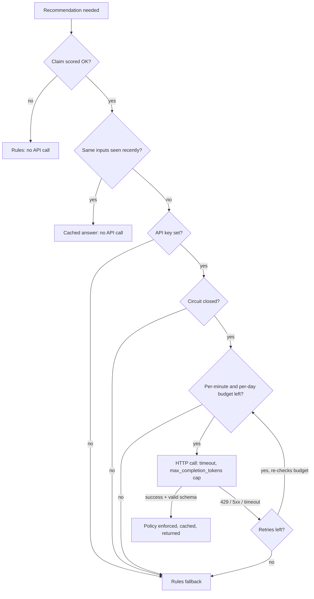

| Guard | Default | Env var |
|---|---|---|
| Calls per minute (every HTTP attempt counts, retries included) | 10 | `GROQ_MAX_CALLS_PER_MINUTE` |
| Calls per day | 200 | `GROQ_MAX_CALLS_PER_DAY` |
| Output tokens per call | 600 | `GROQ_MAX_OUTPUT_TOKENS` |
| Request timeout | 20 s | `GROQ_TIMEOUT_S` |
| Retries after the first attempt | 1 | `GROQ_MAX_RETRIES` |
| Longest `retry-after` on a 429 that is waited out | 5 s | `GROQ_MAX_RETRY_WAIT_S` |
| Circuit opens after N consecutive failures / cooldown | 3 / 60 s | `GROQ_BREAKER_FAILURES`, `GROQ_BREAKER_COOLDOWN_S` |
| Identical-input cache lifetime | 1 h | `GROQ_CACHE_TTL_S` |
| `POST /claims` per client IP per minute | 20 | `CLAIMS_PER_MINUTE_PER_CLIENT` |

Only claims that are actually scored reach Groq, and an identical score + evidence prompt is answered from the cache. Keep these numbers under your Groq plan's limits. `GET /health` shows how much of the budget is used and whether the circuit is open (never the key).

<sub>[↑ Back to contents](#contents)</sub>

## Local setup

**Prerequisites:** Python 3.12+ with [`uv`](https://docs.astral.sh/uv/), Node.js + npm, and optionally a Groq API key from [console.groq.com/keys](https://console.groq.com/keys).

```bash
# 1. Backend dependencies
uv sync

# 2. Frontend dependencies
cd frontend && npm ci && cd ..

# 3. Configuration
cp .env.example .env     # set GROQ_API_KEY; AUTH_DISABLED=true there skips the login locally
```

There is **no index to build**: similar claims are computed from `data/insurance_claims.csv` at startup.

Run two terminals:

```bash
# Terminal 1: backend, from the project root          -> http://127.0.0.1:8000
uv run uvicorn main:app --reload

# Terminal 2: frontend                                -> http://localhost:5173
cd frontend && npm run dev
```

Run **one** backend worker: the rate limiters, Groq budget, circuit breaker and cache live in process memory.

To test the real login locally, leave `AUTH_DISABLED` unset and run `uv run python scripts/hash_password.py` to generate `ADMIN_PASSWORD_HASH` and `JWT_SECRET` for your `.env`.

<sub>[↑ Back to contents](#contents)</sub>

## Configuration

All settings are environment variables, read from the process environment or an untracked `.env` file (see [`.env.example`](.env.example)). Secrets are read at call time, never logged, and never returned by any endpoint.

| Variable | Default | Purpose |
|---|---|---|
| `ENVIRONMENT` | `development` | `production` enables JSON logs and HSTS, disables the API docs, and refuses unsafe settings. |
| `AUTH_DISABLED` | _(unset)_ | Skip login. **Development only**; refused in production. |
| `ADMIN_USERNAME` | _(required in production)_ | The operator's username. |
| `ADMIN_PASSWORD_HASH` | _(required in production)_ | scrypt hash from `scripts/hash_password.py`. Never a plain password. |
| `JWT_SECRET` | _(required in production)_ | At least 32 random characters; different per environment. |
| `TOKEN_TTL_MINUTES` | `480` | Session length. |
| `LOGIN_ATTEMPTS_PER_MINUTE` | `5` | Login attempts per client per minute. |
| `GROQ_API_KEY` | _(unset)_ | Groq key. Unset means rules fallback only. |
| `GROQ_MODEL` | `openai/gpt-oss-20b` | Which models you can use depends on your Groq organisation: `curl -H "Authorization: Bearer $GROQ_API_KEY" https://api.groq.com/openai/v1/models`. Choose one that supports JSON mode. |
| `GROQ_REASONING_EFFORT` | `low` | For gpt-oss models (measured: about 175 vs 495 tokens of the 600-token cap). **Set it empty for non-reasoning models such as Llama**; Groq answers 400 to an unsupported value. |
| `CORS_ORIGINS` | `http://localhost:5173,http://127.0.0.1:5173` | Your deployed frontend URL(s), comma separated, no trailing slash. Never `*`. |
| `CLAIMS_PER_MINUTE_PER_CLIENT` | `20` | Submission rate limit. |
| `MAX_BODY_BYTES` | `65536` | Larger request bodies get a 413. |
| `DATA_DIR` | `data` | Where the SQLite files live. **On a host with an ephemeral filesystem this must be a persistent disk.** |
| `CLAIMS_DB_PATH`, `FEEDBACK_DB_PATH` | `$DATA_DIR/*.db` | Individual file overrides. |
| `MODEL_PATH`, `CSV_PATH` | `models/model.pkl`, `data/insurance_claims.csv` | Fraud model and historical claims. |
| `LOG_LEVEL`, `LOG_FORMAT` | `INFO`, `json` in production | One JSON object per line in production. |

The Groq limit variables are listed [above](#limiting-groq-api-calls). The frontend reads one build-time variable, `VITE_API_URL` (see [`frontend/.env.example`](frontend/.env.example)).

<sub>[↑ Back to contents](#contents)</sub>

## Deployment: Render + Vercel

The API runs on **Render**, the frontend on **Vercel**. [`render.yaml`](render.yaml) and [`frontend/vercel.json`](frontend/vercel.json) describe both.

> **Verification status.** I ran the API exactly as Render will (production mode, the same uvicorn flags, login required, live Groq) and all end-to-end checks passed. I could **not** deploy to Render or Vercel from here, so the two config files follow the platforms' documented behaviour but have not been run on them. See [first-deploy notes](#first-deploy-notes).

### Choose the Render plan

| | Free | Starter + disk (what `render.yaml` describes) |
|---|---|---|
| Memory | 512 MB: **enough**, the app measured about 200 MB | 512 MB |
| Claims and feedback survive restarts | **No.** The filesystem is wiped on every deploy and restart | **Yes**, on the 1 GB persistent disk |
| Sleeps when idle | Yes, after about 15 minutes; the first request takes up to a minute | No |
| Fit | A demo | Production |

Pick the free plan only for a demo: investigators' work would disappear. To use it, set `plan: free`, and delete the `disk:` block and the `DATA_DIR` variable in `render.yaml`.

### Step 1: generate your secrets (locally)

```bash
uv run python scripts/hash_password.py
```

It asks for a password (hidden, at least 12 characters) and prints `ADMIN_PASSWORD_HASH`. Render generates `JWT_SECRET` for you. Never commit either value.

### Step 2: deploy the API on Render

1. Push the repository to GitHub (private is fine).
2. Render dashboard -> **New** -> **Blueprint** -> select the repository.
3. Fill in the prompted variables: `ADMIN_USERNAME`, `ADMIN_PASSWORD_HASH`, `GROQ_API_KEY`, and `CORS_ORIGINS` (use a placeholder such as `https://placeholder.example` for now; you do not have the Vercel URL yet).
4. Wait for the build, then open `https://<your-service>.onrender.com/health`. You want `"status":"ok"`, `"fraud_model_loaded":true`, `"retrieval":{"ready":true,"documents":1000}` and `"llm":{"configured":true,...}`.

### Step 3: deploy the frontend on Vercel

1. Vercel -> **Add New Project** -> import the same repository.
2. Set **Root Directory** to `frontend` (the framework preset resolves to Vite).
3. Add the environment variable `VITE_API_URL` = `https://<your-service>.onrender.com` (no trailing slash). It is baked in at **build** time, so redeploy after changing it.
4. Deploy and copy the resulting URL.

### Step 4: connect the two

1. In Render -> your service -> **Environment**, set `CORS_ORIGINS` to the exact Vercel URL (for example `https://claimguard.vercel.app`, no trailing slash). Saving redeploys the API.
2. Open the Vercel URL and sign in with the username and password from step 1.
3. Submit a claim. The recommendation badge should read **Groq (openai/gpt-oss-20b)**.

Vercel **preview** deployments get different URLs that are not in `CORS_ORIGINS`, so they cannot call the API unless you add them. If you use a custom domain for the API, also update `connect-src` in `frontend/vercel.json`.

### Production checklist

- [ ] Strong, unique operator password; `ADMIN_PASSWORD_HASH` set; `JWT_SECRET` is Render's generated value, not reused anywhere else.
- [ ] `ENVIRONMENT=production`, and `AUTH_DISABLED` is **not** set (the server refuses to start otherwise).
- [ ] A Groq key dedicated to this project, with a spend limit set in the Groq console, and the `GROQ_MAX_CALLS_*` caps under your plan's limits.
- [ ] `CORS_ORIGINS` lists only your Vercel URL.
- [ ] A persistent disk is mounted and `DATA_DIR` points at it (otherwise data is lost on deploy).
- [ ] You know your backup route: Render disk snapshots (check the retention in your dashboard) and, for an off-platform copy, a periodic `sqlite3 /var/data/claims.db ".backup ..."` through Render's shell.
- [ ] You have run a **restore** at least once; an untested backup is a hope.
- [ ] `GET /health` is monitored (Render's health check is configured; add an external uptime check if you want alerts).
- [ ] The Render service stays at **one instance and one worker**.
- [ ] Rotation plan: a leaked Groq key is revoked in the Groq console; a leaked `JWT_SECRET` is rotated by changing it (this signs everyone out).

### First-deploy notes

These are the places a first deploy is most likely to need a small adjustment, because I could not test them on the platforms:

- **Python version.** `render.yaml` sets `PYTHON_VERSION=3.12.8`. If Render rejects it, use a 3.12.x version from Render's supported list.
- **Build.** `pip install uv && uv sync --frozen --no-dev` installs from the lockfile with hash verification. If Render's build image lacks something, the log shows it; the install is a plain `uv sync`.
- **Start command** uses `.venv/bin/uvicorn`, the environment `uv sync` creates inside the project folder.
- **Real client IPs.** The start command passes `--proxy-headers --forwarded-allow-ips='*'` so the per-client rate limits see the real caller behind Render's proxy. Without it every request would share one limit.
- **Persistent disk path.** If you change the mount path, change `DATA_DIR` to match.

<sub>[↑ Back to contents](#contents)</sub>

## API reference

| Method | Endpoint | Auth | Description | Errors |
|---|---|---|---|---|
| `GET` | `/health` | public | Liveness, fraud-model status, retrieval readiness, Groq configured / circuit / budget usage | |
| `GET` | `/auth/config` | public | `{"auth_required": bool}`; tells the frontend whether to show a login | |
| `POST` | `/auth/login` | public | `username` + `password` -> `{access_token, token_type, expires_in}` | `401` invalid credentials, `429` too many attempts |
| `POST` | `/claims` | token | Run the pipeline and persist the claim. Returns `claim`, `fraud_result`, `similar_claims`, `similar_claims_summary`, `recommendation`, `warnings` | `401`, `413` body too large, `422` invalid input, `429` rate limited |
| `GET` | `/claims?limit=&offset=` | token | Newest-first summary page (`limit` 1-500, default 100) | `401`, `422` |
| `GET` | `/claims/{id}` | token | Full detail for one claim | `401`, `404` |
| `POST` | `/claims/{id}/feedback` | token | `investigator_decision`: `agreed` / `overridden_to_approve` / `overridden_to_investigate`; `confirmed_fraud_reported`: `Y` / `N` | `401`, `404`, `409` already reviewed, `422` |

Send the token as `Authorization: Bearer <token>`. Numeric bounds on `POST /claims` are intentionally wider than the training range: a value outside the training range is accepted and routed to manual review, while nonsense (negative age, an hour of 99, a 500-character string) is rejected. Interactive docs (`/docs`) exist only outside production.

<sub>[↑ Back to contents](#contents)</sub>

## Feedback loop and retraining

- **Retrieval learns immediately.** A confirmed claim is added to the similarity index right after feedback is saved. At startup the index is rebuilt from the historical CSV plus every feedback row in the database, so it is a derived cache and never a second store to keep consistent.
- **The classifier learns on demand.** A Random Forest cannot be updated one row at a time, so feedback accumulates in `feedback.db` and you retrain deliberately:

```bash
uv run python retrain_model.py --dry-run   # evaluate only, writes nothing
uv run python retrain_model.py             # promote only if the gate passes
```

Retraining is **gated**. A stratified 20% holdout is scored (ROC-AUC, precision, recall, F1) for the candidate (original data + feedback) and for a **baseline** trained the same way on the same split from the original rows only, so the gate answers "does the new feedback help or hurt?". The candidate is promoted only if its AUC is at least 0.70 and is not more than 0.03 below the baseline. The production model is also scored, for information only: it trained on most of the holdout, so its numbers are optimistic and are deliberately not the bar. On promotion the previous model is archived to `models/archive/`, the new one is written atomically, and `models/model_meta.json` records the metrics. **Restart the API afterwards** to load the new model. `--force` overrides a failed gate.

Measured with `--dry-run` on the committed data (1,000 rows, 200-row holdout):

| Model | ROC-AUC | Precision | Recall | F1 |
|---|---|---|---|---|
| Candidate (original + feedback) | 0.831 | 0.632 | 0.720 | 0.673 |
| Baseline (original only) | 0.829 | 0.621 | 0.720 | 0.667 |
| Production model (saw most of the holdout, **not** a fair estimate) | 0.962 | 0.677 | 0.880 | 0.765 |

The honest expectation for unseen claims is therefore the first two rows (AUC around 0.83), not the production model's figure.

<sub>[↑ Back to contents](#contents)</sub>

## Testing

```bash
uv run python -m pytest -q
```

**174 tests**, all passing. The suite never touches the network: SQLite files are temporary, Groq is replaced by a fake, and the pipeline tests run on the no-evidence fallback path. It covers:

- **Guards:** budget, circuit breaker, cache and rate limiter on a fake clock.
- **The Groq client:** retry cap, no retry on auth errors, `retry-after` handling, JSON mode, and that the key never reaches a log.
- **The recommendation node:** schema validation, policy enforcement, backfilled steps, caching, and every fallback path.
- **Authentication:** password hashing, token expiry, tampering and `alg=none` forgery, startup validation, login rate limiting, and that the disable flag cannot bypass auth in production.
- **Request protections:** body limit (declared and streamed), security headers, request ids, safe 500s, CORS.
- **Retrieval:** ranking, explanations, determinism, failure modes, and the leave-one-out evaluation.
- **Persistence:** migrations, idempotent feedback, and the retraining gate.

Static gates, all clean on the application code:

```bash
uvx ruff check . --select E,F,W,B,UP,S
uv run --no-project --with bandit python -m bandit -r agents retrieval db scripts *.py -q
uv export --frozen --no-hashes --no-emit-project -o req.txt && uv run --no-project --with pip-audit python -m pip_audit -r req.txt --no-deps   # currently: No known vulnerabilities found
```

<sub>[↑ Back to contents](#contents)</sub>

## Project structure

```
.
├── main.py                      FastAPI app: validation, auth routes, rate limits, endpoints
├── auth.py                      scrypt passwords, JWT tokens, fail-closed startup checks
├── middleware.py                body limit, request ids, access log, security headers
├── logging_setup.py             JSON structured logging with request ids
├── config.py                    environment-driven settings
├── graph.py                     LangGraph pipeline with per-step guards + warnings channel
├── resilience.py                budget, circuit breaker, TTL cache, per-client rate limiter
├── claims_data.py               shared loading/cleaning of the historical claims
├── retrain_model.py             gated retraining (holdout metrics, archive, atomic write)
├── agents/
│   ├── fraud_node.py            Random Forest scoring; never raises
│   ├── groq_client.py           guarded Groq client
│   ├── recommendation_node.py   schema validation, policy in code, cache, rules fallback
│   └── feedback_node.py         idempotent feedback + best-effort index update
├── retrieval/
│   ├── similarity.py            interpretable Gower similarity index
│   └── retrieval_node.py        top-5 evidence + fraud rate over the 15 nearest
├── db/claims_store.py           SQLite store (WAL, safe connections, pagination, migrations)
├── scripts/
│   ├── hash_password.py         generate ADMIN_PASSWORD_HASH + JWT_SECRET
│   └── evaluate_retrieval.py    reproduce the retrieval-quality numbers
├── frontend/                    React + Vite dashboard (login, claims, detail)
│   └── vercel.json              headers / CSP / build settings for Vercel
├── render.yaml                  Render blueprint for the API
├── tests/                       pytest suite
├── docs/images/                 README screenshots
├── data/insurance_claims.csv    historical claims (training + retrieval)
└── models/model.pkl             trained classifier
```

<sub>[↑ Back to contents](#contents)</sub>

## Operations

- **Health:** `GET /health` returns `fraud_model_loaded`, `retrieval.ready` / `retrieval.documents`, and `llm.configured` / `circuit` / `budget`. Render's health check uses it.
- **Logs:** in production, one JSON object per line with `ts`, `level`, `logger`, `message` and `request_id`. Each request logs `method`, `path`, `status` and `duration_ms` (never the query string, body or headers). Every response carries an `X-Request-ID`; quote it when investigating an error.
- **What to alert on:** `circuit: open` in `/health` (Groq failing), `budget` near its limits, `fraud_model_loaded: false`, and a rising count of `Failed login attempt` log lines.
- **Rotating secrets:** change `GROQ_API_KEY`, `ADMIN_PASSWORD_HASH` or `JWT_SECRET` in Render's Environment tab and let it redeploy. Changing `JWT_SECRET` signs everyone out.
- **Updating dependencies:** change `pyproject.toml`, run `uv lock`, run the tests and the audit, then deploy. The build installs from the lockfile only.

<sub>[↑ Back to contents](#contents)</sub>

## Troubleshooting

| Symptom | Cause and fix |
|---|---|
| The app says "Connecting to the server..." for a minute | The Render instance was asleep (free plan). It wakes on the first request; use **Retry** if it errors. |
| Browser shows a CORS error calling the API | `CORS_ORIGINS` on Render does not exactly match the page's origin (scheme + host, no trailing slash). Fix it and let Render redeploy. |
| Sign-in loops back to the login screen | The token expired (8 h) or `JWT_SECRET` changed. Sign in again. A page refresh also signs you out by design. |
| `429 Too many login attempts` | Wait for `Retry-After` seconds. |
| Server refuses to start: "Authentication is enabled but ... is not set" | Set `ADMIN_USERNAME`, `ADMIN_PASSWORD_HASH` and `JWT_SECRET`, or (local only) `AUTH_DISABLED=true`. |
| Server refuses to start: "AUTH_DISABLED must not be set" | You set `AUTH_DISABLED` with `ENVIRONMENT=production`. Remove it. |
| Every recommendation says "Rules fallback" | Check `GET /health`: `llm.configured` false means no `GROQ_API_KEY`; `circuit: open` means recent failures (wait for the cooldown); a `budget` at its limit means the caps were reached. |
| Groq returns 400 | `GROQ_REASONING_EFFORT` is set for a non-reasoning model: set it empty. Or the model is not available to your key: list yours via `/openai/v1/models`. |
| Warning "Historical claims could not be loaded" | `data/insurance_claims.csv` is missing or unreadable on the server. |
| `fraud_model_loaded: false` | `models/model.pkl` is missing or unreadable (see the server log); restore it or run `retrain_model.py --force`. |
| Claims disappear after a deploy or restart | No persistent disk: set one up and point `DATA_DIR` at it. |
| `409` on feedback | The claim was already reviewed; feedback is accepted once per claim. |
| `npm : File ...npm.ps1 cannot be loaded` (Windows PowerShell) | Use `npm.cmd run dev`, or `Set-ExecutionPolicy -Scope CurrentUser RemoteSigned`. |
| `An Application Control policy has blocked this file` (Windows) | Smart App Control rejected an unsigned launcher. Use `uv run python -m uvicorn ...`, or see Windows Security -> Protection history for the blocked file. |
| `DeprecationWarning` from `numpy_pickle` during tests | Harmless today: the committed model was pickled with an older NumPy. Retraining re-saves it with the installed versions. |

<sub>[↑ Back to contents](#contents)</sub>

## Known limitations

These are real gaps, not roadmap decoration:

- **One shared operator account.** There are no per-user accounts, roles or per-user audit trail, no MFA, and a token cannot be revoked before it expires (8 h) except by rotating `JWT_SECRET`. Fine for one team lead or a small trusted group; not for a large organisation.
- **Limits are per process and in memory.** The Groq budget, circuit breaker, cache and rate limiters reset on restart and are not shared between instances. Run one instance, or move them to a shared store such as Redis before scaling out.
- **SQLite on one instance.** It is simple and fast and the right size for this workload, but it ties the API to a single instance with a disk. Move to Postgres to scale horizontally or to get managed backups.
- **Protected attributes are model inputs.** `insured_sex`, `age`, education, occupation and relationship are features of the fraud model. Review this for fairness and regulatory compliance before relying on the score for real decisions.
- **Small, public dataset.** The model is trained on 1,000 rows (24.7% fraud) of the public Kaggle auto-insurance dataset. On a held-out 20% it reaches an AUC of about 0.83 with precision around 0.63 and recall around 0.72 (see [retraining](#feedback-loop-and-retraining)), so roughly one in three flagged claims is a false alarm. The 0.5 decision threshold is neither tuned nor calibrated.
- **Similarity is a weak-to-moderate signal.** The fraud rate among similar claims scores an AUC of 0.77 on its own, well below the classifier. It is context for the investigator, not proof.
- **The LLM adds explanation, not new information.** It sees only the fraud score, signals and the similar-claims statistic. It can be conservative (it may recommend `investigate` for a low-score claim); the policy rules only stop it from being *less* cautious than the fraud model.
- **The model is a pickle.** Only load model files you trained yourself. The API must be restarted to pick up a retrained model.
- **Fraud signals are rules, not model explanations.** SHAP-style attributions are not implemented.
- **Tabular input only.** There is no claim narrative, document, photo, policy-coverage or cross-claim link analysis.
- **Platform config is untested on the platforms.** See [first-deploy notes](#first-deploy-notes).

<sub>[↑ Back to contents](#contents)</sub>

## License

A personal portfolio project, a re-implementation of work originally done with an OpenAI API key, now using Groq. No license file is included; all rights reserved unless one is added.
